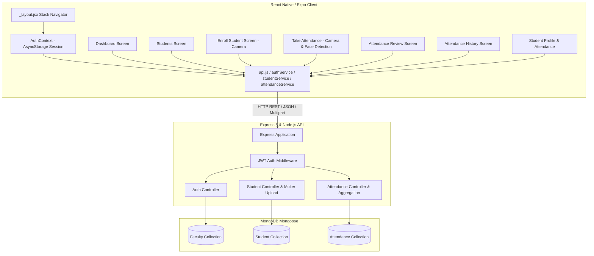

# SmartPresence — Comprehensive Performance Audit Report

**Date:** March 2026  
**Auditor:** Senior Mobile & Backend Performance Engineering  
**Application:** SmartPresence (React Native / Expo Android & Express.js / MongoDB Backend)  
**Status:** Audit Complete (Phase 1) — Ready for Phased Optimization  

---

## 1. Executive Summary

This audit is an in-depth performance analysis of the **SmartPresence** mobile application and backend server. SmartPresence is an automated, facial-recognition-assisted attendance management system designed for colleges and universities.

The audit was conducted **without rewriting or breaking existing features**, strictly respecting the project's JavaScript/JSX architecture, Expo Router navigation, Express.js backend, and MongoDB database.

The codebase is functional and cleanly structured, but contains notable performance bottlenecks:
1. **Server-side database memory leaks & unindexed full collection scans:** Dashboard statistics load all historical attendance records into Node.js process memory using JavaScript loops.
2. **Unnecessary network payloads:** "Take Attendance" screen fetches the entire college student roster over the network just to obtain distinct class names.
3. **UI thread freezing on navigation:** Dashboard completely unmounts and remounts its entire view tree on every focus with a full-screen loading spinner.
4. **Unvirtualized list rendering:** Attendance review renders lists via `.map()` inside a `ScrollView`, causing layout recalculation and frame drops when toggling student presence.
5. **Redundant requests & lack of debouncing:** Search inputs trigger instantaneous API calls on every keystroke.
6. **Asset & dependency bloat:** Dead files from project initialization (`App.js`, `index.js`), unused dependencies (`expo-file-system`), and uncompressed app icon assets.

---

## 2. Current Architecture

### A. Mobile Architecture
* **Framework:** React Native 0.86.3 with Expo ~57.0.27 (New Architecture enabled).
* **Language:** JavaScript (ES6+) with JSX only.
* **Routing:** `expo-router` using file-based Stack routing (`app/_layout.jsx`).
* **State Management:**
  * Global session managed via `AuthContext.jsx` with persistent token storage in `@react-native-async-storage/async-storage`.
  * In-memory session store (`attendanceSession.js`) bridging camera capture, face detection, and roster review.
  * Local component state (`useState`, `useRef`) for screen data and forms.
* **Camera & Processing:** `expo-camera` (CameraView) and `expo-image-manipulator` for image compression and face region analysis.
* **Networking:** Centralized fetch wrapper (`services/api.js`) handling Bearer authorization headers and errors, backed by modular service files (`authService`, `studentService`, `attendanceService`).

### B. Backend Architecture
* **Runtime:** Node.js with Express.js 5.1.0.
* **Structure:** Classic layered MVC structure:
  * `src/server.js`: Process bootstrapping and MongoDB connection.
  * `src/app.js`: Express configuration, CORS, JSON parsing (10MB limit), static file serving (`/uploads`), centralized error handling.
  * `src/routes/`: Route declarations for `/api/auth`, `/api/students`, `/api/attendance`.
  * `src/controllers/`: Business logic, validation, response generation.
  * `src/middleware/`: JWT verification (`auth.middleware.js`) and error handler (`error.middleware.js`).
  * `src/utils/`: JWT sign/verify, validation helpers.

### C. Database Architecture
* **Engine:** MongoDB via Mongoose 8.16.2.
* **Collections & Schemas:**
  * `Faculty`: Faculty profile and authentication (`facultyId`, `email`, `department`, `passwordHash`).
  * `Student`: Enrolled student details (`studentId`, `rollNumber`, `className`, `department`, `faceImageUrl`, `createdBy`).
  * `Attendance`: Recorded sessions (`className`, `subject`, `date`, `capturedImageUrl`, `facultyId`, `students: [{ studentId, status, markedAt }]`).
* **Connection Management:** Single pooled Mongoose connection instantiated at boot via `src/config/db.js`.

---

## 3. Problems Found

| # | File | Problem | Severity | Why It Affects Performance | Recommended Fix |
|---|------|---------|----------|----------------------------|-----------------|
| 1 | `server/src/controllers/attendance.controller.js` | `getAttendanceStats` executes `Attendance.find()` without filters or projection, pulling the entire attendance collection into Node.js memory and looping through all students in JS | **CRITICAL** | As attendance records grow over a term, this causes massive heap memory usage, blocks the Node.js event loop, creates high disk I/O, and causes slow dashboard loading | Replace unconstrained `Attendance.find()` and JS loops with a single MongoDB aggregation query (`$group`, `$project`) |
| 2 | `mobile/app/faculty/take-attendance.jsx` | `loadClasses` calls `getStudents()` with no query filters to extract unique class names | **CRITICAL** | Fetches every single student record (names, roll numbers, photos, emails) over cellular/Wi-Fi just to get 2 or 3 distinct class names | Add lightweight `GET /api/students/classes` (or projection `select('className')`) returning only distinct class strings |
| 3 | `mobile/app/faculty/dashboard.jsx` | `useFocusEffect` calls `setLoading(true)` on every screen focus, mounting the full-screen `<Loading />` spinner | **HIGH** | Every time the faculty navigates back to Dashboard, the entire UI is destroyed and replaced with a loading spinner, causing layout thrashing and perceived lag | Render dashboard layout immediately; display cached stats while updating in the background without unmounting |
| 4 | `mobile/app/faculty/attendance-review.jsx` | Renders the entire student list using `studentList.map()` inside a standard `ScrollView` | **HIGH** | All student cards with avatars and state are kept in memory at once; toggling presence re-renders all elements simultaneously, causing frame drops on Android | Convert `ScrollView + map()` to an optimized virtualized `FlatList` with memoized item components |
| 5 | `mobile/app/faculty/students.jsx` | `handleSearch` calls `loadStudents(text)` directly on `onChangeText` without debouncing | **HIGH** | Typing a name triggers an API request on every keystroke (5-8 rapid requests), causing network queueing, server load, and race conditions | Add a 300ms debounce to the search input handler |
| 6 | `server/src/models/Attendance.js` | Missing indexes on `date`, `createdAt`, `students.studentId`, and `facultyId` | **HIGH** | Queries such as student attendance lookup (`students.studentId`) and date queries run full collection scans (COLLSCAN) | Add compound and single indexes on `date`, `students.studentId`, and `createdAt` |
| 7 | `server/src/models/Student.js` | Missing indexes on `className` and `department` | **HIGH** | Filtering students by class or department runs unindexed scans | Add indexes on `className` and `department` in the Student schema |
| 8 | `server/src/controllers/student.controller.js` & `attendance.controller.js` | Endpoints `getStudents` and `getAttendance` return unbounded result sets without pagination | **HIGH** | As college data increases to hundreds/thousands of records, response payloads balloon in size, slowing JSON parsing and mobile network transfer | Add optional page and limit query parameters while maintaining backward-compatible responses |
| 9 | `mobile/app/faculty/enroll-student.jsx` & `attendance-review.jsx` | Direct `fetch()` and `AsyncStorage` usage duplicating the centralized API service | **MEDIUM** | Bypasses centralized error handling, duplicates authentication header code, causes inconsistent error handling | Route multipart form uploads cleanly through `studentService` and `attendanceService` |
| 10 | `mobile/components/StudentCard.jsx` & `AttendanceCard.jsx` | Cards are not wrapped in `React.memo` | **MEDIUM** | Whenever parent screen state changes (e.g. search text, refresh indicator), every card item re-evaluates and re-renders | Wrap cards in `React.memo` with appropriate props comparison |
| 11 | `mobile/app/faculty/students.jsx` & `attendance-history.jsx` | `FlatList` missing performance windowing props (`initialNumToRender`, `windowSize`, `maxToRenderPerBatch`, `removeClippedSubviews`) | **MEDIUM** | Default FlatList renders larger windows than necessary and keeps offscreen items mounted, wasting memory | Configure tuned windowing props on all `FlatList` components |
| 12 | `mobile/assets/icon.png` | App icon file is 393 KB (uncompressed PNG) | **MEDIUM** | Increases overall bundle size and Android APK footprint | Compress icon while preserving crisp visual quality |
| 13 | `mobile/app.json` | `adaptiveIcon` points to `./assets/adaptive-icon.png` which does not exist in `assets/` | **MEDIUM** | Can cause build failures or missing adaptive icons in production Android builds | Update path to `./assets/android-icon-foreground.png` |
| 14 | `mobile/App.js` & `mobile/index.js` | Dead boilerplate files from `create-expo-app` unused by `expo-router` | **LOW** | Confusing dead code; `package.json` main entry points to `expo-router/entry` | Remove dead template files |
| 15 | `mobile/package.json` | `expo-file-system` declared in dependencies but never imported | **LOW** | Unused native module overhead in project dependencies | Remove `expo-file-system` after confirming zero imports |
| 16 | `mobile/services/studentService.js` | Unused imports `AsyncStorage` and `TOKEN_KEY` | **LOW** | Unnecessary imports in service bundle | Remove unused imports |
| 17 | `mobile/app/faculty/attendance-history.jsx` & `take-attendance.jsx` | Unused imports `useCallback`, `Loading` | **LOW** | Unnecessary imports in bundle | Clean up unused imports |
| 18 | `mobile/utils/attendanceSession.js` | In-memory session references not cleared if user cancels or leaves attendance flow | **LOW** | Large classroom photo URIs and face arrays remain held in memory | Ensure session cleanup occurs on workflow cancel or unmount |

---

## 4. Optimization Opportunities

### 1. Startup Performance
* **Session Restoration:** `AuthContext` already reads token from `AsyncStorage`. Ensure initial route checks auth synchronously from state without duplicate `/api/auth/me` calls on subsequent screens.
* **Deferred Data Loading:** Never fetch student lists or statistics in root `_layout`.
* **Lightweight Initial View:** Keep `index.jsx` minimal, immediately navigating to Dashboard or Login based on restored token.

### 2. UI Performance
* **Eliminate Screen-Level Loading Flickers:** Dashboard should mount its shell immediately. Replace full-screen loading spinners on return visits with localized placeholder or skeleton elements.
* **Memoize Card Components:** Wrap `StudentCard` and `AttendanceCard` in `React.memo` so list re-renders only affect changed elements.
* **Component Splitting:** Extract attendance review student rows into standalone memoized items so status toggles only re-render the single clicked row.

### 3. Navigation
* **Clean Screen Unmounting:** Ensure heavy screens (Camera in `take-attendance` and `enroll-student`) unmount camera hardware immediately upon leaving the camera view.
* **Avoid Screen Stacking:** Use `router.replace` where workflows complete (e.g., after saving attendance or logging out).

### 4. Network Performance
* **Debounced Searches:** 300ms debounce on student name and history filters.
* **Class Names Endpoint:** Dedicated endpoint returning `["CS-A", "IT-B"]` instead of loading 500 complete student objects.
* **Lean Responses:** Ensure endpoints do not return unneeded internal database properties or full populated documents when only IDs and names are needed.

### 5. Image Performance
* **Image Downscaling on Capture:** Already using `ImageManipulator` (width 400 for student profile, width 1000 for classroom). Maintain quality compression at 0.7–0.8 JPEG.
* **Avatar Sizing:** List views display 52×52 or 44×44 avatars; avoid fetching full uncompressed images for list items.

### 6. Memory Usage
* **Virtualized Lists:** Replace all `.map()` rendering inside `ScrollView` with `FlatList`.
* **State Cleanup:** Clear captured photo URI and face bounding box arrays once attendance is submitted or canceled.
* **Avoid Base64 in State:** Continue using file URIs and multipart form uploads; never convert camera frames to large base64 strings in React state.

### 7. JavaScript Execution
* **Backend Aggregation:** Move attendance calculation loops out of Node.js JavaScript into MongoDB aggregation queries.
* **Memoized Computations:** In `attendance-history.jsx`, wrap total calculations in `useMemo` based on `records`.

### 8. Bundle Size
* **Remove Unused Package:** `expo-file-system`.
* **Remove Orphan Template Files:** `App.js` and `index.js`.
* **Compress Asset Icons:** Optimize `icon.png` from 393 KB down to ~80 KB without visible degradation.

### 9. Backend Performance
* **Lean Queries:** Use `.lean()` in Mongoose read queries where documents do not need Mongoose methods (e.g. `getStudents`, `getAttendance`, `getMe`).
* **Field Selection:** Project only fields needed by screens (`.select('name rollNumber studentId className department faceImageUrl')`).

### 10. MongoDB Performance
* **Compound & Single Indexes:**
  * `Attendance`: `{ 'students.studentId': 1 }`, `{ date: 1 }`, `{ createdAt: -1 }`.
  * `Student`: `{ className: 1 }`, `{ department: 1 }`.
* **Aggregation Pipeline for Stats:** Compute `totalStudents`, `todaySessions`, `todayPresent`, `todayTotal`, and `averageAttendance` in MongoDB.

---

## 5. Dependencies Analysis

### Mobile (`mobile/package.json`)

| Dependency | Used? | Necessary? | Heavy? | Action |
|---|---|---|---|---|
| `@react-native-async-storage/async-storage` | Yes | Yes | No | **Keep** — Essential for JWT auth token persistence |
| `expo` | Yes | Yes | Medium | **Keep** — Core framework |
| `expo-camera` | Yes | Yes | Medium | **Keep** — Required for student photo enrollment and classroom capture |
| `expo-constants` | Peer | Yes | Low | **Keep** — Required peer dependency of `expo-router` |
| `expo-file-system` | **No** | **No** | Medium | **Remove** — Not imported anywhere; file uploads use standard React Native `FormData` |
| `expo-image-manipulator` | Yes | Yes | Low | **Keep** — Essential for client-side image compression and resizing |
| `expo-linking` | Peer | Yes | Low | **Keep** — Required by Expo Router |
| `expo-router` | Yes | Yes | Medium | **Keep** — Core navigation framework |
| `expo-splash-screen` | Yes | Yes | Low | **Keep** — App startup splash screen control |
| `expo-status-bar` | Yes | Yes | Low | **Keep** — Status bar styling |
| `react` | Yes | Yes | Core | **Keep** — React 19.2.3 |
| `react-native` | Yes | Yes | Core | **Keep** — React Native 0.86.3 |
| `react-native-gesture-handler`| Yes | Yes | Medium | **Keep** — Gesture support for navigation |
| `react-native-safe-area-context`| Yes | Yes | Low | **Keep** — Safe area insets |
| `react-native-screens` | Yes | Yes | Medium | **Keep** — Native screen management for Expo Router |

### Server (`server/package.json`)

| Dependency | Used? | Necessary? | Heavy? | Action |
|---|---|---|---|---|
| `bcryptjs` | Yes | Yes | Low | **Keep** — Password hashing |
| `cors` | Yes | Yes | Low | **Keep** — Cross-origin requests |
| `dotenv` | Yes | Yes | Low | **Keep** — Environment configuration |
| `express` | Yes | Yes | Core | **Keep** — HTTP API framework |
| `jsonwebtoken` | Yes | Yes | Low | **Keep** — JWT token issuance and verification |
| `mongoose` | Yes | Yes | Core | **Keep** — MongoDB ODM |
| `multer` | Yes | Yes | Low | **Keep** — Multipart image upload handling |
| `nodemon` | Dev | Dev | Low | **Keep** — Local dev reload |

---

## 6. Implementation Plan by Phases

* **Phase 2:** Clean confirmed unused dependencies (`expo-file-system`), dead template files (`App.js`, `index.js`), unused imports, asset configuration.
* **Phase 3:** Startup & navigation optimization (eliminate full-screen loading on dashboard return, smooth transitions).
* **Phase 4:** API optimization (centralize multipart uploads, add debounced search, class-names endpoint).
* **Phase 5:** React rendering & list optimization (virtualize `AttendanceReviewScreen`, memoize cards, configure `FlatList` windowing props).
* **Phase 6:** Image & camera resource management (asset compression, ensure memory reference cleanup).
* **Phase 7:** Face detection pipeline workflow optimization (isolated state, prevent redundant processing).
* **Phase 8:** Backend API optimization (lean queries, field projections, lightweight error handling).
* **Phase 9:** MongoDB query optimization (indexes, aggregation pipeline for statistics).
* **Phase 10:** Validation, automated testing, regression test suite verification, and final `PERFORMANCE_RESULTS.md` report.
